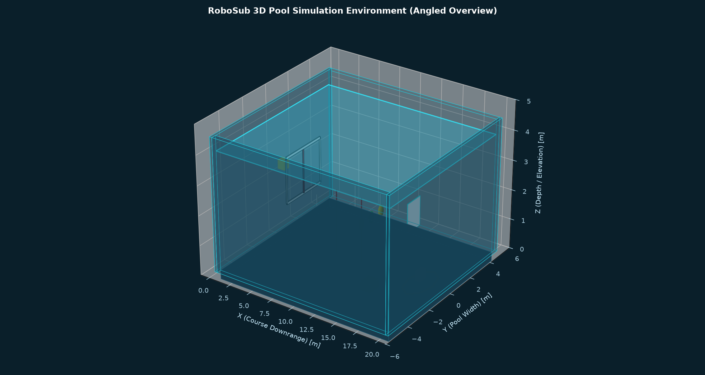

# RoboSub Underwater Gazebo Simulation Environment

[](LICENSE)
[](https://gazebosim.org/)
[](http://sdformat.org/)
[-brightgreen.svg)](tests/)

A realistic, modular, high-fidelity underwater pool simulation environment inspired by the international **RoboSub** Autonomous Underwater Vehicle (AUV) competition, built for **Gazebo Sim** (Harmonic / Garden / Fortress).

---

## 1. Project Overview

This repository provides an autonomous underwater robotics testing and simulation environment modeled after official RoboSub competition rules and specifications (RoboNation *Storm Response* and Autonomy Challenge rulesets). The environment includes a full competition pool, authentic obstacle structures with collision geometry, computer-vision-ready optical tuning, procedural configuration generation, and validation test suites.



---

## 2. Key Features and Implemented Course Elements

- **Rectangular Competition Pool:** $20.0\text{ m} \times 10.0\text{ m} \times 4.5\text{ m}$ structural pool with $4.0\text{ m}$ water depth, non-penetrating collision boundaries, slate aquatic floor material, and center navigational lane strip.
- **Starting Gate (Task 1 – Begin Assessment):** $120\text{ in} \times 60\text{ in}$ ($3.05\text{ m} \times 1.52\text{ m}$) PVC frame with vertical center divider splitting the gate into dual $1.5\text{ m}$ clear corridors, vertical mooring legs, and official corrugated plastic marker panels:
  - *Starboard (Right) upright:* Upper half RED, lower half BLACK (*"Red, Right, Above"*).
  - *Port (Left) upright:* Upper half BLACK, lower half RED.
- **Slalom Obstacle Course (Task 2 – Avoid Debris):** Six vertical $2.2\text{ m}$ PVC slalom poles moored to the floor with weighted bases, alternating red and white color coatings, staggered laterally to provide a challenging navigation channel ($>1.4\text{ m}$ clearance).
- **Buoy Target Array:** Multi-color spherical targets (Red, Green, Yellow) moored at mid-depth ($z = 2.0\text{ m}$) for visual classification and docking.
- **Recon Target Bins (Task 3 – Recon):** Dual-compartment floor bin with high-contrast perimeter walls and color-coded bottom target symbols (Red for *Survey & Repair*, Blue for *Search & Rescue*) for marker drop scoring.
- **Torpedo Target Board (Task 4 – Deploy):** Vertical freestanding board with weighted floor base and two concentric circular apertures (Large $30\text{ cm}$ aperture and Small $15\text{ cm}$ aperture) with high-contrast target rings.
- **Surfacing / Resupply Octagon (Task 5 – Resupply & Return Home):** $9\text{ ft}$ ($2.74\text{ m}$) diameter octagonal perimeter floor marking, central $2\text{ ft} \times 2\text{ ft}$ ($0.61\text{ m} \times 0.61\text{ m}$) resupply table, and acoustic pinger transducer housing placeholder.
- **Path Navigation Markers:** High-visibility orange navigation strips ($1.22\text{ m} \times 0.15\text{ m}$) placed along the floor between mission stations.
- **Generic AUV Reference Model:** Autonomous underwater vehicle placeholder ($0.80\text{ m} \times 0.40\text{ m} \times 0.30\text{ m}$, $25\text{ kg}$) featuring forward optical sensor dome, downward camera well, 6 thruster duct cowlings, and top deck heading arrow.
- **Perception-Ready Underwater Visuals:** Blue-cyan subsurface ambient illumination, directional water-penetrating sunlight with soft shadows, and deep aquatic depth haze.
- **Procedural Regeneration Pipeline:** Master YAML configuration (`config/environment.yaml`) driving automated model and world generation.

---

## 3. Course Layout and Geometry

```
                      +Y (10m width)
           +5.0m ┌──────────────────────────────────────────────┐
                 │                                              │
                 │              [Target Board]                  │
                 │                 (X=14.2)                     │
   AUV Start     │     [Slalom Course]                          │
    (X=1.0)      │     (X=6.5 to 11.5)        [Octagon Zone]    │
  ----->         │ [Gate]                     (X=17.5, Y=0.0)   │ ---> +X (20m length)
   Y=0.0         │ (X=3.5)                     [Pinger/Table]   │
                 │                                              │
                 │     [Buoy Array]   [Bins]                    │
                 │       (X=12.8)     (X=14.0)                  │
                 │                                              │
           -5.0m └──────────────────────────────────────────────┘
                 0.0m                                         20.0m
```

Detailed layout coordinates and navigation corridors are documented in [docs/COURSE_LAYOUT.md](docs/COURSE_LAYOUT.md).

---

## 4. Repository Structure

```
underwater_gazebo/
├── config/
│   └── environment.yaml           # Master environment parameters
├── docs/
│   ├── ROBOSUB_RESEARCH.md        # Official competition research and dimensions
│   ├── ENVIRONMENT_DESIGN.md      # Physical and optical architecture
│   ├── COURSE_LAYOUT.md           # Schematic diagram, coordinates table, clearances
│   └── TROUBLESHOOTING.md         # Solutions for paths, rendering, and plugins
├── evidence/
│   └── screenshots/               # Multi-angle 3D visual evidence
│       ├── pool_overview_angled.png
│       ├── course_layout_overhead.png
│       ├── gate_closeup_3d.png
│       ├── slalom_course_view.png
│       ├── targets_and_mission_zone.png
│       └── auv_placeholder_view.png
├── models/                        # Modular SDFormat 1.9 models
│   ├── pool/                      # Pool floor, walls, and water plane
│   ├── gate/                      # 120"x60" gate with indicator boxes
│   ├── slalom_pole/               # Red/white slalom poles with bases
│   ├── buoy/                      # Moored spherical targets
│   ├── target_bin/                # Dual-compartment marker bins
│   ├── target_board/              # Torpedo board with dual cutouts
│   ├── octagon_zone/              # 9ft octagon, table, and pinger
│   ├── path_marker/               # Orange navigation strips
│   └── auv_placeholder/          # Generic AUV reference model
├── scripts/
│   ├── generate_layout.py         # Procedural layout generator
│   ├── render_scene_views.py      # Multi-angle 3D renderer
│   ├── launch_world.sh            # Gazebo launcher (Bash / Linux / WSL)
│   ├── launch_world.ps1           # Gazebo launcher (PowerShell / Windows)
│   ├── validate_world.sh          # Validation runner (Bash)
│   └── validate_world.ps1         # Validation runner (PowerShell)
├── tests/
│   ├── test_sdf_structure.py      # Unit tests for XML, SDF syntax, geometry
│   └── test_model_references.py   # Unit tests for URIs, clearances, boundaries
├── worlds/
│   └── robosub_pool.sdf           # Main Gazebo Sim world file
├── .gitignore
├── LICENSE                        # Apache 2.0 License
└── README.md
```

---

## 5. Prerequisites and Installation

### Software Requirements
- **Operating System:** Ubuntu 24.04 LTS / Ubuntu 22.04 LTS / WSL2 (Windows Subsystem for Linux) / Windows 11.
- **Simulator:** Gazebo Harmonic (`gz-harmonic`) or Gazebo Garden (`gz-garden`). Gazebo Fortress (`ign-fortress`) is supported via SDFormat 1.8 compatibility.
- **Python:** Python 3.8+ with `PyYAML` and `matplotlib` (for layout generation and test suites).

### Setting Up Python Dependencies
```bash
pip install pyyaml matplotlib
```

### Installing Gazebo Harmonic (Ubuntu / WSL2)
```bash
sudo apt-get update && sudo apt-get install -y lsb-release wget gnupg
sudo wget https://packages.osrfoundation.org/gazebo.gpg -O /usr/share/keyrings/pkgs-osrf-archive-keyring.gpg
echo "deb [arch=$(dpkg --print-architecture) signed-by=/usr/share/keyrings/pkgs-osrf-archive-keyring.gpg] http://packages.osrfoundation.org/gazebo/ubuntu-stable $(lsb_release -cs) main" | sudo tee /etc/apt/sources.list.d/gazebo-stable.list > /dev/null
sudo apt-get update && sudo apt-get install -y gz-harmonic
```

---

## 6. Launch Instructions

### Option A: Using the Automated Launcher Script (Recommended)

**On Linux / Ubuntu / WSL2:**
```bash
chmod +x scripts/launch_world.sh scripts/validate_world.sh
./scripts/launch_world.sh
```

**On Windows (PowerShell):**
```powershell
powershell -ExecutionPolicy Bypass -File scripts/launch_world.ps1
```

The launch script dynamically resolves project paths, configures `GZ_SIM_RESOURCE_PATH` and `SDF_PATH`, checks for Gazebo binaries, and boots the simulation.

### Option B: Manual Terminal Launch
```bash
export GZ_SIM_RESOURCE_PATH="$(pwd)/models:${GZ_SIM_RESOURCE_PATH}"
export SDF_PATH="$(pwd)/models:${SDF_PATH}"
gz sim -r worlds/robosub_pool.sdf
```

---

## 7. Environment Configuration and Customization

The course layout, dimensions, object placements, and optical parameters are controlled by `config/environment.yaml`.

To modify the course (e.g., adjust pool size, change pole coordinates, or alter lighting):
1. Edit `config/environment.yaml`.
2. Regenerate the models, world SDF, and layout diagrams:
   ```bash
   python scripts/generate_layout.py
   ```
3. Re-run tests to verify geometry and clearances:
   ```bash
   python -m unittest discover -s tests -v
   ```

---

## 8. Validation and Automated Testing

An automated test suite validates the environment's structural and spatial integrity across 9 comprehensive test cases:

```bash
# Run tests via script
./scripts/validate_world.sh

# Or directly with Python unittest
python -m unittest discover -s tests -v
```

### Verified Test Results
```
test_all_included_models_resolve (test_model_references.TestModelReferences)
Verify that every model:// URI in the world file resolves locally under models/. ... ok
test_gate_clearance_for_auv (test_model_references.TestModelReferences)
Verify that the starting gate opening is wide enough for the AUV placeholder. ... ok
test_pool_boundaries_contain_all_objects (test_model_references.TestModelReferences)
Verify all course objects are strictly positioned within the pool boundaries. ... ok
test_slalom_pole_count_and_colors (test_model_references.TestModelReferences)
Verify at least six slalom poles exist in the world with proper clearances. ... ok
test_all_models_xml_valid (test_sdf_structure.TestSDFStructure)
Verify every model.sdf in the models/ tree is valid XML with link and visual elements. ... ok
test_no_duplicate_model_names_in_world (test_sdf_structure.TestSDFStructure)
Ensure no duplicate names exist among top-level included entities in the world. ... ok
test_world_file_exists (test_sdf_structure.TestSDFStructure)
Verify the main world SDF file exists on disk. ... ok
test_world_required_elements (test_sdf_structure.TestSDFStructure)
Verify that required world children exist: world, physics, scene, light. ... ok
test_world_xml_well_formed (test_sdf_structure.TestSDFStructure)
Verify that the world file is valid, parseable XML. ... ok

Ran 9 tests in 0.019s - OK
```

---

## 9. Simulation Evidence and Visual Inspection

Multi-angle high-resolution 3D renders representing the exact SDF geometric coordinates, material color definitions, and lighting angles are provided in `evidence/screenshots/`:

| Element | Description | Evidence Preview |
| :--- | :--- | :--- |
| **Complete Course** | Angled 3D overview of the pool, walls, floor, and all stations | [pool_overview_angled.png](evidence/screenshots/pool_overview_angled.png) |
| **Top-Down Layout** | Orthographic 2D schematic map with coordinates and paths | [course_layout_overhead.png](evidence/screenshots/course_layout_overhead.png) |
| **Starting Gate** | Close-up of PVC frame, dual passages, and marker boxes | [gate_closeup_3d.png](evidence/screenshots/gate_closeup_3d.png) |
| **Slalom Poles** | Slalom channel with alternating red/white poles | [slalom_course_view.png](evidence/screenshots/slalom_course_view.png) |
| **Missions & Octagon** | Recon bins, buoys, torpedo board, and 9ft octagon | [targets_and_mission_zone.png](evidence/screenshots/targets_and_mission_zone.png) |
| **Generic AUV** | Submarine hull, thrusters, camera dome, and heading arrow | [auv_placeholder_view.png](evidence/screenshots/auv_placeholder_view.png) |

---

## 10. Known Limitations

1. **Host Environment Execution:** Gazebo Sim runtime requires an operating system with Gazebo Harmonic installed (Ubuntu 24.04/22.04 or WSL2). On Windows hosts without Gazebo, static validation passes completely, but live simulator launch must be executed inside WSL2.
2. **Acoustic Sensor Emulation:** The acoustic pinger model provides geometric and visual presence on the pool floor. Hydrophone triangulation requires an acoustic sensor plugin (such as the DAVE acoustic pinger plugin or custom ROS 2 topic publisher).
3. **Marker Drop Manipulation:** The recon bins feature accurate physical collision boundaries. Active projectile dropping or torpedo firing requires vehicle-side actuator controllers.

---

## 11. Research References and Attribution

- **RoboSub Official Portal:** [https://robosub.org/](https://robosub.org/)
- **RoboNation Team Handbook:** [https://robonation.gitbook.io/robosub-resources](https://robonation.gitbook.io/robosub-resources)
- **Gazebo Sim Documentation:** [https://gazebosim.org/docs/harmonic/](https://gazebosim.org/docs/harmonic/)
- Full research notes and rule derivations are documented in [docs/ROBOSUB_RESEARCH.md](docs/ROBOSUB_RESEARCH.md).

---

## 12. License

This project is licensed under the Apache License 2.0. See [LICENSE](LICENSE) for details.
